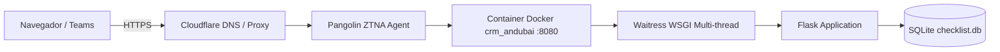

# 🏛️ Arquitetura e Estrutura do Projeto CRM Andubai

Este documento descreve detalhadamente a arquitetura interna, o fluxo de dados, a organização de diretórios e os padrões adotados no desenvolvimento do CRM Checklist Pós-Venda.

---

## 📂 Mapa de Diretórios

```
crm_andubai/
├── app/                           # Código-fonte principal da aplicação
│   ├── __init__.py                # App Factory (create_app), extensões e rotas globais
│   ├── cli.py                     # Comandos de terminal (flask diagnostico, backup, etc.)
│   ├── extensions.py              # Instâncias do SQLAlchemy, Migrate, etc.
│   ├── manutencao.py              # Rotinas de diagnóstico de integridade e backup de banco
│   ├── painel_veg.py              # Métricas e agregações da fila
│   ├── publico_teen.py            # Regras e detecção de público teen
│   ├── texto.py                   # Utilitários de normalização de strings e texto
│   ├── importacao/                # Pipeline de importação e processamento de planilhas
│   │   ├── __init__.py            # Exceções de importação e contratos
│   │   ├── base_alunos.py         # Leitura da planilha semanal de alunos (aba Base)
│   │   ├── checklist.py           # Leitura do relatório de checklist exportado da Egali (CSV)
│   │   ├── consultores.py         # Mapeamento e reconciliação de nomes de consultores
│   │   ├── leitor_csv.py          # Parser e normalizador de arquivos CSV
│   │   ├── leitor_excel.py        # Leitor de alta velocidade (.xlsx/.xlsb/.xls) com Calamine
│   │   ├── pautas.py              # Leitor, parser (CSV/MHTML) e upsert inteligente de pautas TM
│   │   ├── rotulos.py             # Dicionários de rotulagem e legendas de importação
│   │   └── valores.py             # Parsers de datas, números e valores monetários
│   ├── models/                    # Modelos ORM (SQLAlchemy)
│   │   ├── __init__.py            # Exportação centralizada dos modelos
│   │   ├── base.py                # Modelo base com helpers comuns
│   │   ├── cadastro.py            # Usuário, Papel (Enum), ApelidoConsultor
│   │   ├── catalogo.py            # Trilha, Etapa, Servico, ApelidoProcedimento
│   │   ├── importacoes.py         # Importacao, OcorrenciaImportacao, Gravidade
│   │   ├── pautas.py              # Pauta, PautaAnotacao, ColaboradorSetor
│   │   └── tarefas.py             # Aluno, Tarefa, HistoricoTarefa, StatusTarefa
│   ├── static/                    # Arquivos estáticos (CSS puro, imagens, logos)
│   │   ├── estilo.css             # Folha de estilos completa com tema dark/light
│   │   └── logo-victoria.png      # Identidade visual
│   ├── templates/                 # Templates HTML (Jinja2)
│   │   ├── base.html              # Template mestre com navbar, menu de usuário e flash messages
│   │   ├── entrar.html            # Tela de login individual por e-mail e senha
│   │   ├── trocar_senha.html      # Tela de primeiro acesso / alteração de senha
│   │   ├── fila.html              # Tela principal de visualização da fila
│   │   ├── pautas.html            # Tela de Pautas por Consultor (Pipeline em Etapas / Tabela)
│   │   ├── tarefa.html            # Detalhes, observação e edição da tarefa
│   │   ├── cadastros/             # Telas administrativas (usuários, pautas/setores, etapas, trilhas)
│   │   ├── filas/                 # Parciais das visualizações (Lista, Kanban, Quadro, Calendário)
│   │   ├── importacoes/           # Telas de upload e prévia de importação
│   │   └── painel/                # Dashboard de métricas e início
│   └── web/                       # Blueprints e controladores web
│       ├── __init__.py            # Registro dos blueprints na aplicação
│       ├── auth.py                # Autenticação, login, logout, primeiro acesso
│       ├── cadastros.py           # CRUD de usuários, apelidos, catálogo e mapeamento de setores
│       ├── filas.py               # Visualizações da fila de tarefas
│       ├── importacoes.py         # Upload e confirmação de planilhas
│       ├── painel.py              # Dashboard inicial
│       ├── pautas.py              # Visualização de pautas por consultor, etapas, notas e JSON
│       ├── programas.py           # Visão do programa do aluno e checklist
│       └── tarefas.py             # Ações sobre tarefas (status, data planejada, observação)
├── instance/                      # Dados dinâmicos locais (ignorado no Git)
├── REGRAS_PAUTAS.md               # Documentação detalhada da lógica de negócio e regras de pautas
│   ├── .gitkeep                   # Garante a existência da pasta no Git
│   ├── checklist.db               # Banco de dados SQLite local
│   └── backups/                   # Backups automáticos do banco
├── migrations/                    # Scripts de migração Alembic (Flask-Migrate)
├── scripts/                       # Scripts auxiliares para inicialização e automação
├── tests/                         # Testes automatizados (pytest)
│   ├── test_andamento.py          # Testes de cálculo de progresso do aluno
│   ├── test_auth.py               # Testes de autenticação, hashing de senhas e primeiro acesso
│   └── test_leitor_excel.py       # Testes do leitor Calamine/Excel com offsets e tipos
├── .env.example                   # Exemplo de variáveis de ambiente
├── .gitignore                     # Proteção contra vazamento de bancos, chaves e caches
├── config.py.exemplo              # Arquivo de configuração de exemplo para produção
├── Dockerfile                     # Construção da imagem Docker baseada em Python Slim
├── docker-compose.yml             # Orquestração do serviço com volume persistente de dados
├── iniciar.cmd                    # Inicializador automático para ambiente Windows
├── iniciar_linux.sh               # Inicializador automático para ambiente Linux
├── pytest.ini                     # Configuração da suíte de testes
├── requirements.txt               # Dependências Python do projeto
├── servidor.py                    # Ponto de entrada do servidor de produção Waitress
└── wsgi.py                        # Objeto WSGI para servidores web
```

---

## 🔒 1. Fluxo de Autenticação e Permissões

- **Modelo de Segurança:**
  - Senhas são armazenadas utilizando `werkzeug.security.generate_password_hash` (PBKDF2 com Salt).
  - Cada usuário possui um `Papel` (definido no Enum `Papel` em `app/models/cadastro.py`):
    - `ADMIN`: Acesso total, incluindo cadastros de usuários, importação e catálogo.
    - `CONSULTOR`: Acesso à visualização de filas, alunos, edição de tarefas e notas.
    - `ESTAGIARIO`: Acesso operacional às filas de atendimento.
- **Primeiro Acesso:**
  - Usuários importados da planilha inicial sem senha cadastrada ao tentar fazer login com seu e-mail recebem o redirecionamento automático para a tela de **Primeiro Acesso** (`/primeiro-acesso`), onde definem sua senha individual com confirmação.
- **Controle de Sessão:**
  - A sessão Flask armazena `usuario_id`, `usuario_nome`, `usuario_email` e `usuario_papel`.
  - Decorator `@admin_necessario` em `app/web/auth.py` protege rotas administrativas.

---

## 📊 2. Mecanismo de Importação de Dados

O sistema possui dois pipelines de importação isolados com suporte a **prévia antes da confirmação**:

1. **Importação da Base de Alunos (`app/importacao/base_alunos.py`):**
   - Lê planilhas com formato de linhas de cabeçalho dinâmicas (utilizando `python-calamine` para processar milhares de linhas em milissegundos).
   - Localiza colunas como Aluno, NEG, Consultor, Destino, Data de Embarque e Status.
   - Atualiza o cadastro dos alunos e associa ao consultor correto via normalização de nomes e apelidos cadastrados.

2. **Importação do Checklist Egali (`app/importacao/checklist.py`):**
   - Lê arquivos CSV exportados do sistema da Egali.
   - Identifica tarefas e procedimentos por aluno.
   - Atualiza o status das tarefas existentes sem apagar o histórico e observações internas feitas pela equipe.

---

## 🗄️ 3. Banco de Dados e Persistência

- **Engine Padrão:** SQLite 3 armazenado em `instance/checklist.db` (ou no volume persistente `/dados` no Docker).
- **Integridade Referencial:**
  - `Usuario` $\leftrightarrow$ `ApelidoConsultor` (1:N)
  - `Aluno` $\leftrightarrow$ `Tarefa` (1:N)
  - `Tarefa` $\leftrightarrow$ `HistoricoTarefa` (1:N)
  - `Importacao` $\leftrightarrow$ `OcorrenciaImportacao` (1:N)
- **Estratégia de Backup:**
  - O comando `flask backup` gera cópias atômicas do SQLite com timestamp na pasta de backups e remove automaticamente versões mais antigas de acordo com a política de retenção (`BACKUPS_MANTER`).

---

## 🌐 4. Infraestrutura e Publicação Externa



- **Container Docker:** Roda com imagem `python:3.12-slim`, utilizando `waitress` como servidor WSGI multithread de alta performance.
- **Túnel Seguro:** Acesso remoto exposto via **Pangolin ZTNA** sem necessidade de abrir portas no roteador.
