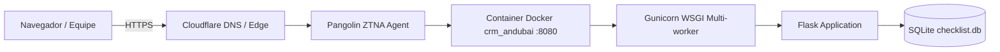

# 🏛️ Arquitetura e Estrutura do Projeto CRM Andubai

Este documento descreve detalhadamente a arquitetura interna, o fluxo de dados, a organização de diretórios e os padrões adotados no desenvolvimento do CRM Checklist Pós-Venda.

---

## 📂 Mapa de Diretórios

```
crm_andubai/
├── app/                           # Código-fonte principal da aplicação
│   ├── __init__.py                # App Factory (create_app), extensões, segurança e rotas globais
│   ├── acoes_tarefa.py            # Operações em tarefas (status, datas, lançamentos, notas)
│   ├── andamento.py               # Motor de cálculo de progresso até o embarque
│   ├── catalogo_inicial.py        # Carga padrão do catálogo de trilhas e etapas
│   ├── cli.py                     # Comandos de terminal (flask diagnostico, backup, etc.)
│   ├── consultas.py               # Consultas, filtros, agrupamentos ("Organizar por") e agregações
│   ├── extensions.py              # Instâncias do SQLAlchemy, Migrate, etc.
│   ├── manutencao.py              # Rotinas de diagnóstico de integridade e backup de banco
│   ├── painel_veg.py              # Métricas e agregações da fila
│   ├── publico_teen.py            # Regras e detecção de público teen
│   ├── texto.py                   # Utilitários de normalização de strings e texto
│   ├── vistos.py                  # Normalização e rotulagem de tipos de vistos de alunos
│   ├── importacao/                # Pipeline de importação e processamento de planilhas
│   │   ├── __init__.py            # Exceções de importação e contratos
│   │   ├── base_alunos.py         # Planilha semanal (não é mais importada; usada só nos testes)
│   │   ├── rsa_checklist.py       # Base do painel RSA montada a partir do checklist
│   │   ├── checklist.py           # Leitura do relatório de checklist exportado da Egali (CSV)
│   │   ├── consultores.py         # Mapeamento e reconciliação de nomes de consultores
│   │   ├── leitor_csv.py          # Parser e normalizador de arquivos CSV
│   │   ├── leitor_excel.py        # Leitor de alta velocidade (.xlsx/.xlsb/.xls) com Calamine
│   │   ├── pautas.py              # Leitor, parser (CSV/MHTML) e upsert inteligente de pautas TM
│   │   ├── rotulos.py             # Dicionários de rotulagem e legendas de importação
│   │   └── valores.py             # Parsers de datas, números e valores monetários
│   ├── models/                    # Modelos ORM (SQLAlchemy 2.x)
│   │   ├── __init__.py            # Exportação centralizada dos modelos
│   │   ├── base.py                # Modelo base com helpers comuns e ComDatas
│   │   ├── cadastro.py            # Usuario (senha_hash, visao_fila, organizar), Papel, Aluno, Compra, Programa
│   │   ├── catalogo.py            # Trilha, EtapaModelo, ServicoEgali, Apelidos
│   │   ├── importacoes.py         # Importacao, OcorrenciaImportacao, Gravidade
│   │   ├── pautas.py              # Pauta, PautaAnotacao, ColaboradorSetor
│   │   └── tarefas.py             # Tarefa (lancada_egali_*), Anotacao, HistoricoTarefa, StatusTarefa
│   ├── static/                    # Arquivos estáticos (CSS puro, imagens, logos)
│   │   ├── estilo.css             # Folha de estilos completa com tema dark/light, dropdowns e selos
│   │   └── logo-victoria.png      # Identidade visual
│   ├── templates/                 # Templates HTML (Jinja2)
│   │   ├── base.html              # Template mestre com navbar, menu de usuário e flash messages
│   │   ├── entrar.html            # Tela de login individual por e-mail e senha
│   │   ├── trocar_senha.html      # Tela de primeiro acesso / alteração de senha
│   │   ├── fila.html              # Tela principal de visualização da fila com filtros e agrupamentos
│   │   ├── concluidas.html        # Auditoria de tarefas concluídas e baixadas
│   │   ├── para_lancar.html       # Fila de itens pendentes de lançamento na Egali
│   │   ├── pautas.html            # Tela de Pautas por Consultor (Pipeline em Etapas / Tabela)
│   │   ├── tarefa.html            # Detalhes, observação e edição da tarefa
│   │   ├── cadastros/             # Telas administrativas (usuários, pautas/setores, etapas, trilhas)
│   │   ├── filas/                 # Parciais das visualizações (Lista, Kanban, Quadro dropdown, Calendário)
│   │   ├── importacoes/           # Telas de upload e prévia de importação
│   │   └── painel/                # Dashboard de métricas e início
│   └── web/                       # Blueprints e controladores web
│       ├── __init__.py            # Registro dos blueprints, context processors e filtros Jinja2
│       ├── auth.py                # Autenticação, login, logout, primeiro acesso e rate-limiting
│       ├── cadastros.py           # CRUD de usuários, apelidos, catálogo e mapeamento de setores
│       ├── filas.py               # Visualizações da fila de tarefas, Concluídas e Para Lançar
│       ├── importacoes.py         # Upload e confirmação de planilhas com filtros de corte
│       ├── painel.py              # Dashboard inicial
│       ├── pautas.py              # Visualização de pautas por consultor, etapas, notas e JSON
│       ├── programas.py           # Visão do programa do aluno e checklist
│       └── tarefas.py             # Ações sobre tarefas (status, datas, lançamento na Egali)
├── instance/                      # Dados dinâmicos locais (ignorado no Git)
│   ├── .gitkeep                   # Garante a existência da pasta no Git
│   ├── checklist.db               # Banco de dados SQLite local com WAL
│   ├── secret_key                 # Chave de sessão gerada na primeira subida
│   └── backups/                   # Backups automáticos do banco
├── migrations/                    # Scripts de migração versionados com Alembic / Flask-Migrate
├── scripts/                       # Scripts auxiliares para inicialização e automação local
├── tests/                         # Suíte de 270 testes automatizados (pytest)
│   ├── amostras/                  # Arquivos fictícios de teste (sem dados pessoais)
│   ├── conftest.py                # Fixtures globais de app, db e client de testes
│   ├── test_andamento.py          # Cálculo de andamento e estimativas de embarque
│   ├── test_auth.py               # Autenticação, hash de senha, rate limit e cabeçalhos HTTP
│   ├── test_catalogo.py           # Catálogo de trilhas e etapas
│   ├── test_filtro_procedimento.py# Filtros por procedimento nas filas
│   ├── test_importacao_base.py    # Importação e reconcile de alunos e compras
│   ├── test_importacao_checklist.py# Importação de tarefas de checklist e prévias
│   ├── test_instalacao.py         # Configuração de dados, backups e diagnósticos
│   ├── test_leitor_excel.py       # Leitor Calamine em arquivos Excel fictícios
│   ├── test_migracoes.py          # Upgrade e downgrade de migrações com dados
│   ├── test_modelos.py            # Modelos e integridade referencial
│   ├── test_painel_veg.py         # Painel VEG e métricas da unidade
│   ├── test_pautas.py             # Pautas TM, sincronização MHTML e setores
│   ├── test_publico_teen.py       # Regras e filtros de público teen
│   ├── test_texto.py              # Normalização de texto e nomes
│   ├── test_valores.py            # Parsers de datas, números e moedas
│   ├── test_visualizacoes.py      # Agrupamentos, ordenações e visões de fila
│   └── test_web.py                # Rotas web, formulários, AJAX e permissões
├── .gitignore                     # Proteção contra vazamento de planilhas, bancos e segredos
├── config.py.exemplo              # Arquivo de configuração de exemplo para produção
├── Dockerfile                     # Imagem Docker com Python Slim e entrada protegida
├── docker-compose.yml             # Orquestração com volume persistente em /dados
├── iniciar.cmd                    # Inicializador Windows (porta 5000)
├── iniciar_linux.sh               # Inicializador Linux
├── pytest.ini                     # Configuração da suíte de testes
├── requirements.txt               # Dependências Python do projeto
├── servidor.py                    # Servidor de produção Waitress (Windows)
└── wsgi.py                        # Ponto de entrada WSGI para Gunicorn / Docker
```

---

## 🔒 1. Fluxo de Autenticação e Permissões

- **Modelo de Segurança:**
  - Senhas são armazenadas utilizando `werkzeug.security.generate_password_hash` (PBKDF2 com Salt).
  - Cada usuário possui um `Papel` (definido no Enum `Papel` em `app/models/cadastro.py`):
    - `ADMIN`: Acesso total, incluindo cadastros de usuários, importação, catálogo e pautas.
    - `CONSULTOR`: Acesso à visualização de filas, alunos, edição de tarefas, pautas e notas.
    - `ESTAGIARIO`: Acesso operacional às filas de atendimento.
- **Primeiro Acesso e Autoatendimento:**
  - Usuários cadastrados sem senha podem utilizar a transição suave com a senha da equipe (quando `LOGIN_PROVISORIO=1`) e são imediatamente redirecionados para a tela de **Trocar Senha** (`/trocar-senha`). Administradores são proibidos de usar a senha provisória da equipe.
- **Proteção contra Brute Force:**
  - Rate-limiting em memória bloqueando IPs ou contas após 10 tentativas falhas consecutivas em uma janela de 15 minutos (HTTP 429).
- **Cabeçalhos de Segurança:**
  - Respostas HTTP contam com `X-Frame-Options: DENY`, `X-Content-Type-Options: nosniff` e `Strict-Transport-Security` quando atrás de proxy HTTPS.

---

## 📊 2. Mecanismo de Importação de Dados

O sistema possui três pipelines de importação isolados com suporte a **prévia antes da confirmação**:

1. **Importação da Base de Alunos (`app/importacao/base_alunos.py`):**
   - Lê planilhas com formato de cabeçalho dinâmico via `python-calamine` em milissegundos.
   - Identifica alunos, programas, compras e consultor responsável via mapeamento de apelidos.
2. **Importação do Checklist Egali (`app/importacao/checklist.py`):**
   - Lê relatórios CSV da Egali, reconciliando procedimentos e datas.
   - Preserva o trabalho manual da equipe e marca tarefas fora do período de corte.
3. **Importação de Pautas TM (`app/importacao/pautas.py`):**
   - Lê arquivos exportados do TM (CSV/MHTML), atualizando status oficial sem sobrescrever notas ou observações internas da unidade AN e Dubai.

---

## 🗄️ 3. Banco de Dados e Migrações

- **Engine Padrão:** SQLite 3 com `PRAGMA journal_mode=WAL`, `foreign_keys=ON` e `busy_timeout=30000`.
- **Controle de Versão do Esquema:**
  - Gerenciado pelo Flask-Migrate (Alembic) em `migrations/versions/`.
  - Migrações são 100% idempotentes e testadas contra upgrade e downgrade em banco populado.
- **Estratégia de Backup:**
  - O comando `flask backup --manter N` realiza backups atômicos online via SQLite Backup API.

---

## 🌐 4. Infraestrutura e Publicação Externa



- **Container Docker:** Baseado em `python:3.12-slim`, sobe com `gunicorn -w 4 -b 0.0.0.0:8080` com trava atômica: caso a migração de banco falhe, o container aborta imediatamente.
- **Túnel Seguro:** Acesso remoto intermediado via **Pangolin ZTNA** sem exposição de portas de borda.
