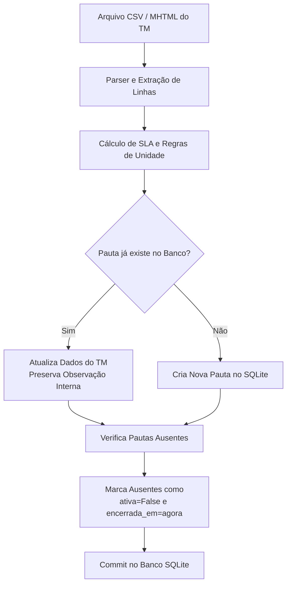

# 📋 Lógica, Arquitetura e Regras de Negócio: Módulo de Pautas TM

Este documento descreve detalhadamente a lógica de negócio, a modelagem de dados, as regras de SLA e a integração das **Pautas de Comunicação Interna (TM Egali)** dentro da aplicação **CRM Andubai**.

---

## 1. Visão Geral e Contexto de Negócio

### O que são as Pautas?
As **Pautas** são os protocolos e chamados formais de comunicação interna dentro do ecossistema da Egali Intercâmbio. Elas conectam a equipe de ponta — o **Suporte ao Aluno (Unidade AN e Dubai)** — a todos os setores operacionais e centrais da matriz e destinos internacionais:
- **Acomodação** (casas de estudantes, albergues, residências, homestays);
- **Vistos e Aplicações** (assessoria consular, documentação);
- **Aéreo e Reembolsos** (emissão de bilhetes, alterações de trecho, cancelamentos, estornos);
- **Matrículas e Operações de Curso** (confirmação com escolas parceiras);
- **Financeiro** (boletos, baixas, pagamentos de comissões e fornecedores);
- **Comercial e Diretoria** (exceções contratuais, negociações especiais).

### O Papel do CRM Andubai
Historicamente, o acompanhamento das pautas dependia da inspeção manual página por página no sistema corporativo (TM) ou de planilhas locais manuais (`Auxiliar!A:B`). O CRM Andubai centraliza essas pautas em um painel unificado que:
1. **Calcula SLAs dinâmicos** para cada categoria de chamado;
2. **Segmenta a visualização por consultor** da unidade (responsável, criador ou vinculado ao aluno);
3. **Identifica pendências ativas** (de quem é a vez de responder);
4. **Alerta quebras de prazo de 72h+** com distinção clara entre atrasos internos da unidade e atrasos dos outros setores;
5. **Permite anotações e observações internas** sem perigo de perda em futuras atualizações da base do TM.

---

## 2. O Princípio Operacional do TM: "Salvar = Atualizar"

Uma particularidade essencial do sistema TM Egali é a mecânica de atualização:
> **"Toda ação de comunicação ou alteração de status no TM exige clicar no botão 'Salvar'."**

Isso implica que:
- Quando um consultor da nossa unidade ou um atendente de outro setor responde uma pauta, o sistema corporativo atualiza imediatamente:
  - `Atualizado em` (data e hora da última ação);
  - `Atualizado por` (nome de quem salvou);
  - `Tempo de Inatividade` (é zerado e reinicia a contagem).
- Se o status muda de "Em aberto" para "Aguardando retorno...", isso também conta como um evento de atualização salvo.

### Como o CRM interpreta isso?
O CRM analisa o par (`Atualizado por`, `Responsável`):
- Se `Atualizado por` pertence à unidade **AN e Dubai**: a bola foi passada para o outro setor ou para o aluno.
- Se `Atualizado por` pertence a um **setor externo** e o `Responsável` é alguém de **AN e Dubai**: a bola voltou para a nossa unidade responder!

---

## 3. Mapeamento de Unidades e Setores

### Substituição da Planilha `Auxiliar!A:B`
No formato de planilha manual, existia uma aba auxiliar mapeando cada colaborador ao seu respectivo setor. No CRM Andubai, esse mecanismo foi incorporado à arquitetura:
1. **Consultores da Unidade:** São os registros da tabela `Usuario` com `ativo = True`. Quando o nome de quem criou, atualizou ou é responsável bate com um usuário do CRM, o sistema atribui o rótulo **`AN e Dubai`**.
2. **Colaboradores Externos:** Ficam registrados na tabela `ColaboradorSetor`, gerenciável pelo painel administrativo em `/cadastros/pautas`. Exemplo:
   - *Nome Sobrenome (colaboradora do setor)* ➔ `Acomodação`
   - *Renata Ferreira* ➔ `Aéreo / Reembolsos`
   - *Fernanda Santos* ➔ `Vistos`

### Os 4 Pilares de Identificação
A partir do mapeamento, cada pauta tem 4 metadados computados:

| Campo Calculado | O que Representa | Como é Determinado |
| :--- | :--- | :--- |
| **`UN Atualizou`** | Quem realizou o último salvamento no TM | Se `Atualizado por` está em `Usuario.ativo` ➔ `'AN e Dubai'`. Caso contrário, busca em `ColaboradorSetor`. |
| **`UN Responsável`** | Quem tem o encargo formal de resolver a pauta | Se `Responsável` está em `Usuario.ativo` ➔ `'AN e Dubai'`. Caso contrário, busca o setor em `ColaboradorSetor`. |
| **`UN Criou`** | Setor que deu origem à solicitação | Se `Criada por` está em `Usuario.ativo` ➔ `'AN e Dubai'`. Caso contrário, setor externo. |
| **`UN Final`** | Síntese operacional de localização | Se `UN Atualizou` for da unidade ➔ `'AN e Dubai'`. Caso contrário, reflete o setor externo responsável. |

---

## 4. Regras de Prazos, SLA e Quebra de 72h+ ("Quebrou")

### Catálogo de SLAs por Categoria
O sistema lê a tabela de prazos por categoria (`app/dados/pautas_sla.csv`, só `categoria;horas`, tirada da lista de categorias do TM; para atualizar sem mexer no código, ponha um `pautas_sla.csv` no mesmo formato na pasta de dados), que define o prazo nominal de resposta em horas para cada assunto (ex: 24h, 48h, 72h, etc.).

### Categorização de Atrasos:
1. **Dentro do Prazo:** Tempo de inatividade menor ou igual ao SLA da categoria (+ tolerância).
2. **Atrasada (`TAG: Atrasada`):** Pauta sem movimentação cujo tempo inativo ultrapassou o SLA nominal.
3. **Quebrou (`72h+`):** Pauta que permaneceu inativa por mais de 72 horas além do limite aceitável.

### A Regra de Ouro da Quebra de 72h:
> **"A pauta quebra estritamente para o setor do `UN Responsável`."**

- **💥 Quebra UN (72h+ na UN):** Ocorre quando `UN Responsável == 'AN e Dubai'` e o chamado está há mais de 72 horas parado. Representa **risco operacional direto** para a nossa unidade, exigindo ação imediata do consultor.
- **⚠️ Quebra Outro (72h+ Outro Setor):** Ocorre quando `UN Responsável != 'AN e Dubai'` (ex: Acomodação ou Vistos) e o chamado passou de 72h sem retorno deles. Representa um chamado travado no parceiro interno, exigindo que o consultor cobre o setor central.

---

## 5. Os 4 Estágios do Pipeline (Visão em Etapas)

O CRM oferece duas visualizações: a **Tabela Detalhada** (para conferência e filtros rápidos) e o **Pipeline por Etapas** (organização visual de fluxo de trabalho):

### 1️⃣ Em Aberto
- **Definição:** Pautas recém-abertas no TM ou que ainda não tiveram atendimento inicial iniciado.
- **Foco:** Triagem, conferência de dados e encaminhamento ao setor de destino.

### 2️⃣ Em Análise / Triagem
- **Definição:** Pautas com status corporativos ativos como *"Em aberto"*, *"Em andamento"*, *"Pendente"*.
- **Foco:** Acompanhamento do trabalho técnico executado pelo setor especialista.

### 3️⃣ Aguardando Retorno (O Estágio Crítico)
Quando o status no TM é *"Aguardando retorno do aluno/fornecedor"*, o CRM desmembra a situação em **3 sub-estados inteligentes**:
- **🚨 Ação Pendente da UN:** O chamado é de nossa responsabilidade (`UN Responsável == 'AN e Dubai'`), mas a última atualização veio de fora. Significa que o aluno ou fornecedor respondeu e nós precisamos dar andamento!
- **👤 Aguardando Nosso Aluno:** A responsabilidade é nossa, mas fomos nós que atualizamos/salvamos por último. Estamos esperando o aluno responder às orientações ou enviar documentos.
- **🏢 Aguardando Outro Setor:** O chamado está com setor externo; estamos apenas monitorando para garantir cumprimento do prazo.

### 4️⃣ Concluídas / Arquivadas
- **Definição:** Pautas finalizadas, resolvidas ou canceladas no TM.
- **Armazenamento:** Mantidas com status inativo no banco de dados para fins de histórico e auditoria.

---

## 6. Persistência de Dados e Estratégia de Upsert Seguro

### O Desafio da Reimportação
Como os dados do TM são exportados periodicamente via CSV (`pautaList-*.csv`) ou MHTML (`pautas_home.mhtml`), o sistema **NÃO pode** simplesmente limpar a tabela e inserir de novo, pois isso apagaria anotações internas da equipe.

### A Estrutura dos Modelos SQLAlchemy
1. **`Pauta` (`app/models/pautas.py`):**
   - Chave primária: `id` (o ID numérico oficial do chamado no TM, ex: `3102692`).
   - Campos do TM: Atualizados a cada importação (`status_tm`, `atualizado_por_tm`, `atualizado_em_tm`, `tag`, `tempo_inativo_horas`, etc.).
   - Campos Internos da Unidade: **Permanentes e intocáveis pela importação** (`observacao`, `observacao_atualizada_em`, `consultor_id`).
   - Flag de arquivamento: `ativa` (booleano) e `encerrada_em` (data).
2. **`PautaAnotacao`:** Histórico de notas adicionadas por usuários internos, com registro de autor e data/hora.
3. **`ColaboradorSetor`:** Tabela de suporte com o catálogo de pessoas externas e seus respectivos departamentos.

### Algoritmo de Sincronização (`sincronizar_pautas_no_banco`):

---

## 7. Painel Administrativo de Configuração (`/cadastros/pautas`)

### Por que esta tela existe?
Novos colaboradores entram na Egali e outros mudam de departamento constantemente. Em vez de exigir que desenvolvedores alterem o código-fonte, o painel administrativo em `/cadastros/pautas` permite:
1. **Adicionar/Editar Setores:** Vincular livremente um nome de colaborador corporativo ao seu setor.
2. **Sugestões Inteligentes de Colaboradores:** O sistema analisa as pautas recém-importadas e detecta automaticamente colaboradores externos que ainda não possuem setor cadastrado, exibindo um botão de preenchimento automático.
3. **Consistência Imediata:** Ao cadastrar o setor de alguém, todas as métricas de `UN Responsável` e quebras de 72h passam a considerar a classificação instantaneamente.

---

## 8. Resumo das Rotas e Endpoints

| Rota | Método | Função |
| :--- | :--- | :--- |
| `/pautas/` | GET | Painel principal de pautas com alternância entre visualização em Pipeline (Etapas) e Tabela, filtros por consultor e busca. |
| `/pautas/upload` | POST | Recebe novos arquivos `.csv` ou `.mhtml` exportados do TM e executa a sincronização com upsert seguro. |
| `/pautas/<id>/observacao` | POST | Endpoint AJAX para edição rápida de anotações internas inline (sem recarregar a tela). |
| `/pautas/exportar-json` | GET | Exporta as pautas filtradas em formato JSON para relatórios externos ou integrações. |
| `/cadastros/pautas` | GET/POST | Tela de administração para mapeamento de colaboradores e setores (`ColaboradorSetor`). |
